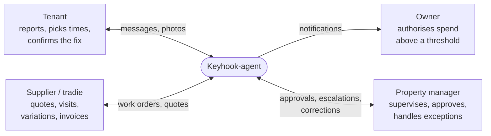
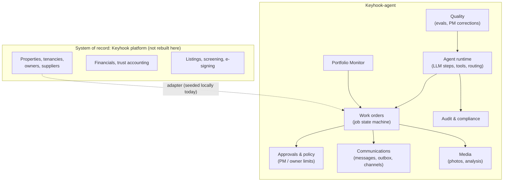
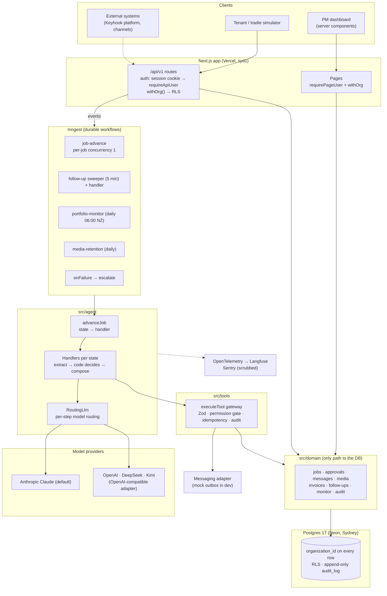
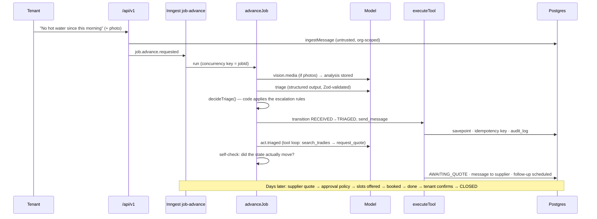
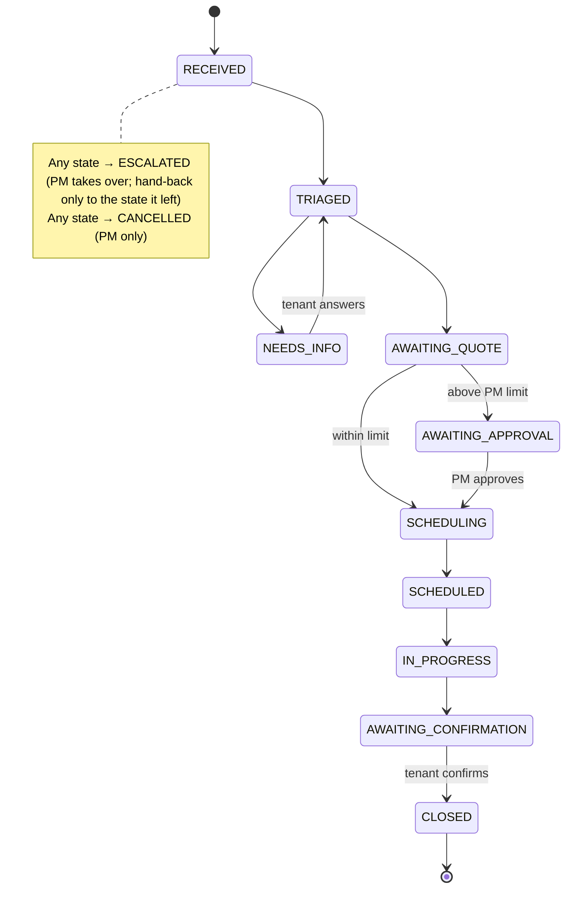
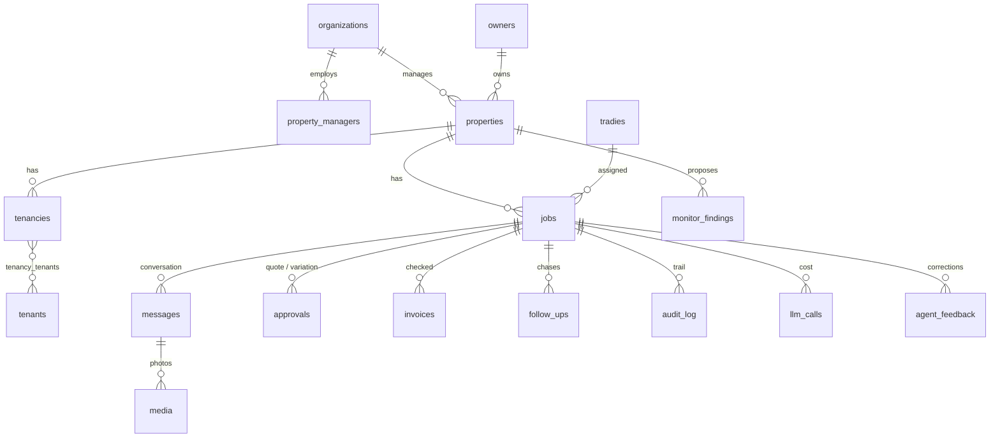
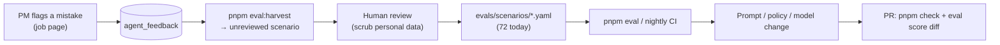
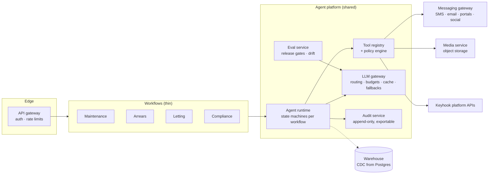
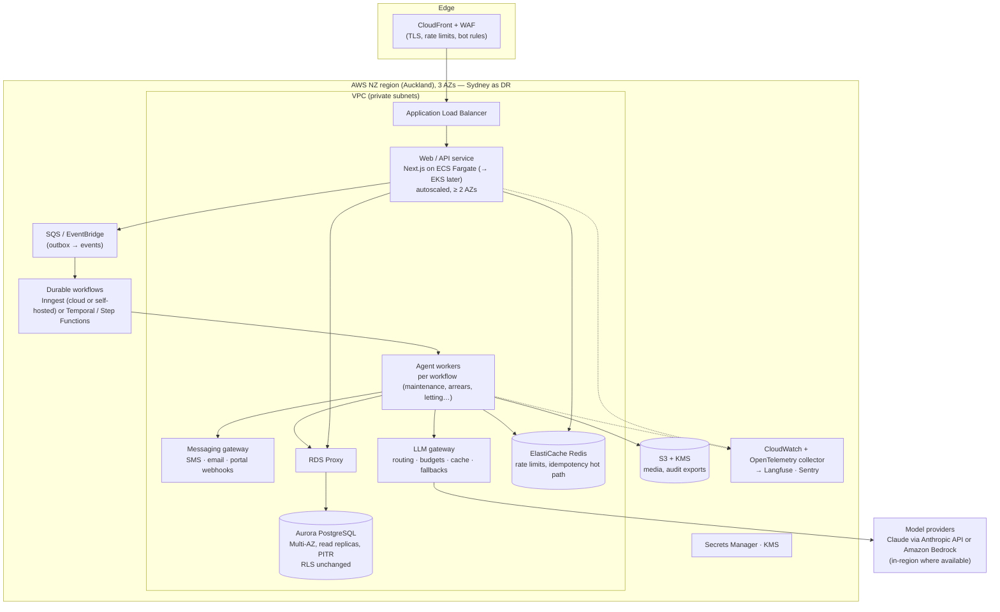

English | [简体中文](architecture.zh-CN.md)

# Keyhook-agent — Architecture (2026-10-18)

Three views: **business** (who, what value, which boundaries), **technical** (how it is built
today), and **evolution** (how it migrates when the scale or scope gets bigger). Business
expansion beyond maintenance is in [`roadmap.md`](roadmap.md). Individual decisions and their
reasons are in [`decisions.md`](decisions.md).

---

## 1. Business architecture

### 1.1 Actors and the work being automated

A maintenance job typically involves four people, three systems and about nine manual steps. The
agent does the coordination: triage, choosing a supplier, chasing quotes, checking approval limits,
agreeing a time, following up, confirming completion and checking the invoice. The PM sees only
what needs judgement or authority. **The PM's role shifts from doing the work to supervising it.**

### 1.2 Value streams

| Value stream | Trigger | Agent does | Human decides | Status |
|---|---|---|---|---|
| Tenant maintenance request | Tenant message (+ photos) | Triage, clarify, quote, approve within limits, schedule, chase, confirm, close | Spend above the PM's limit; emergencies; unclear responsibility | Done (M1–M7) |
| Inspection finding → work order | PM logs a finding | Same as above, tenant told rather than asked | Vague findings | Done (M8) |
| Proactive maintenance | Daily scan | Detects repeated faults, proposes a fix | Whether to open a job | Done (M8) |
| Variations and invoices | Supplier message / invoice photo | Re-checks the new total against the policy; matches the invoice | Variations above limits; invoice differences | Done (M7) |
| Owner communication | Approval needed, job closed | Notifies with cost | — | Done (M7, outbox) |
| Arrears | Missed rent | Reminders, payment plans, drafts notices | Formal notices, Tribunal, hardship, disputes | Done (M9) |

### 1.3 Bounded contexts

In this repository the property, tenancy, owner and supplier data is seeded locally. In production
inside Keyhook, the platform remains the system of record. The agent owns only its own state: job
progress, conversations, decisions, approval records and the audit trail. It reads and writes the
platform through adapters. Listings, screening and accounting stay with the platform (see
[`keyhook-fit.md`](keyhook-fit.md)).

### 1.4 Human/agent boundary (how the agent knows when to stop)

Four tests decide where a person is required: reversibility, impact (money, legal, safety,
housing), confidence and accountability ([`agents.md`](agents.md) §5). In code they become:

- **Tool permission levels** `read | auto | approval`. An `approval` tool needs a stored PM
  decision, or it is not executed.
- **Approval policy**: auto ≤ min(PM limit, owner limit); PM approval ≤ owner limit; escalate above.
- **Escalation rules**: emergency, low confidence, legal/Tribunal, injury, distress, possible
  tenant damage, prompt injection, no supplier, repeated silence.
- **Escalation package**: summary, what has been done, recommended action and evidence links, so a
  PM can decide in about 30 seconds.

### 1.5 Business KPIs the system is built to measure

| KPI | Source today |
|---|---|
| PM touches per job / jobs closed without a PM | `audit_log` actor types per job |
| Time to supplier engaged, time to close | job transitions in `audit_log` |
| Escalation precision / recall | eval suite (Kimi K2.6 baseline 0.88 / 0.97) |
| Unsafe actions | eval "forbidden actions" — must be 0 (baseline 0) |
| AI cost per job | `llm_calls.cost_usd_micros` per job (dashboard shows it) |
| Agent mistakes | PM "Flag an agent mistake" corrections, harvested into evals |

---

## 2. Technical architecture (today)

### 2.1 Shape: a modular monolith, API-first

One Next.js deployment holds the dashboard, the simulator and `/api/v1`. Durable workflows run on
Inngest, and Postgres is the only datastore. Modules talk through interfaces, not network calls.
Each interface is a seam where a module could be extracted later (§3). There are no
microservices: at this size they would only add failure modes. This was decided on 2026-10-17.

### 2.2 Layers and their rules

| Layer | Path | Responsibility | Rule it enforces |
|---|---|---|---|
| Routes & pages | `src/app` | HTTP, auth, input validation (Zod) | Every route requires a session and `withOrg` (a static test checks this) |
| Workflows | `src/workflows` | Events, cron, retries, concurrency | One run per job at a time; failures escalate |
| Agent | `src/agent` | One handler per job state; prompts; model calls | **The state machine decides the next state**; the model chooses within a step |
| Tools | `src/tools` | Side effects, called by handlers or the model | Permission level, idempotency key, audit row, Zod in/out |
| Domain | `src/domain` | Business rules and org-scoped data access | The only path to the DB; every query is scoped by `organization_id` |
| Data | `src/db` | Schema, migrations, seed | Composite FKs per org, CHECK constraints, RLS, an audit trigger |
| Adapters | `src/adapters` | Outbound channels | No real SMS/email in development |

### 2.3 How one inbound message is processed

### 2.4 Job state machine (source of truth)

The model never names a state. Handlers call `transitionJob`, which checks
`src/workflows/state-machine.ts`, uses optimistic locking on `version` and writes the audit row in
the same transaction.

### 2.5 Defence in depth for an LLM that acts

| Risk | Control |
|---|---|
| Model invents a step | State machine in code; the tool loop exists only in TRIAGED, with a self-check afterwards |
| Model spends money | `approval` tools require a stored approval; the policy is computed in code from integer cents |
| Duplicate side effects (retries, concurrent runs) | Idempotency keys scoped to job version + message/follow-up; per-job concurrency; claim-before-act |
| Prompt injection (text or image) | Inbound content wrapped as `<untrusted_message>`; injection flag → escalate, nothing sent |
| Malformed model output | Structured outputs validated by Zod; refusal/parse/config errors → escalate, never guess |
| Cross-agency data leak | `organization_id` on every row, composite FKs, Postgres RLS via the `keyhook_app` role (fails closed) |
| Unaccountable actions | Append-only `audit_log` (DB trigger): who, what, why, inputs, outputs, trace id |
| Personal data offshore | Offshore providers need explicit opt-in (NZ Privacy Act IPP 12); Sentry scrubbing |
| Runaway cost | Simulator spend guard; per-call cost in `llm_calls`; per-step model routing |

### 2.6 Data model (main tables)

Money is stored as integer cents in NZD. Times are stored in UTC and displayed in
Pacific/Auckland. Every table that has `organization_id` has an RLS policy, and a test fails if
one is missing.

### 2.7 Models: pluggable, routed per step, chosen by evals

- One `LlmClient` interface, with Claude as the default. OpenAI, DeepSeek and Kimi go through an
  OpenAI-compatible adapter: JSON-schema output where the provider supports it, otherwise JSON
  mode plus validation.
- Routing order: eval override → organization `llm_routing` → `LLM_DEFAULT_MODEL` /
  `LLM_STEP_MODELS` / `LLM_VISION_MODEL` → Claude. Step groups (`triage`, `act`, `interpret`, `compose`, `vision`) can
  each use a different model, for example a cheap model for composing messages and a strong model
  for triage and vision.
- Optional `fallback` model (`LLM_FALLBACK_MODEL`): a call that fails for provider reasons
  (timeout, 5xx, 429, auth or balance) is retried on it, and a provider whose circuit breaker is
  open (3 failures in 60 s) is skipped for 60 s. Refusals and bad answers do not fail over. Every
  request has a per-step timeout set from measured latency (`src/agent/timeouts.ts`). The breaker
  is per process for now; at scale its counters move to a shared store.
- Each choice is backed by an eval run (`pnpm eval --model provider:model`), not by preference.

### 2.8 Quality loop

### 2.9 Deployment today

| Concern | Choice |
|---|---|
| App | Vercel (`syd1`, closest to NZ), production domain `keyhook-agent.vercel.app` |
| Database | Neon Postgres 17 (Sydney); pooled URL for the app, direct URL for migrations |
| Workflows | Inngest Cloud, synced on the production domain |
| Observability | OpenTelemetry → Langfuse (LLM traces); Sentry (errors, scrubbed); `/api/v1/health` returns 503 while migrations are pending |
| CI | GitHub Actions: `pnpm check` on every push; live evals nightly and on demand |

---

## 3. Evolution: migrating as it grows

The principle is **strangler, not rewrite**. Every likely extraction already sits behind an
interface, so each step swaps one implementation behind it; callers do not change.

| Seam that exists today | Today | When it grows |
|---|---|---|
| `src/adapters/messaging` | Mock outbox | SMS / email / Keyhook portal adapters, delivery receipts, inbound webhooks |
| `LlmClient` / `RoutingLlm` | In-process clients | LLM gateway: budgets per org, caching, fallbacks, batch |
| `media-store.ts` | Postgres `bytea` | Object storage in an NZ/AU region, signed URLs, virus scan |
| `src/domain` (only DB path) | Drizzle on one Postgres | Platform data via Keyhook APIs; read models; replicas |
| `executeTool` + permission levels | Maintenance tools | Shared tool registry and policy engine for every agent |
| Inngest events | Job advance, follow-ups, cron | Same model across agents; outbox pattern for cross-service events |
| `organizations.llm_routing`, workflow policy | JSON config per org | Per-agency autonomy levels and feature flags |

### Stage 1 — inside Keyhook, first production customers

Trigger: real agencies, real channels.

- **Integrate instead of seeding.** Properties, tenancies, suppliers and owner approvals come
  from the Keyhook platform through an adapter. The agent keeps a local projection for its own
  joins. Work order status is pushed back so the platform's portals show progress.
- **Real channels.** SMS/email/portal adapters behind the existing port, with inbound webhooks,
  sender verification, delivery receipts, quiet hours already enforced, and opt-out handling.
- **Autonomy as a setting.** Per agency: "suggest only" → "act with approval" → "act". Agencies
  start conservative and widen autonomy as their own metrics justify it.
- **Release gate.** Eval score and forbidden actions = 0 become required checks for prompt/model
  changes; a canary org gets new prompts first.
- **Data.** Partition `audit_log`, `messages` and `llm_calls` by month; archive old partitions.
  Move media to object storage.

### Stage 2 — many agencies, several agents

Trigger: arrears, letting and compliance agents share the runtime; volume is in the millions of
messages.

- **Extract along the seams, in this order**: messaging gateway (different scaling and
  reliability profile) → LLM gateway (cost control across agents) → media service. The work-order
  core stays a monolith as long as one team owns it.
- **Events.** Keep Inngest for durable per-entity workflows. Add a transactional outbox when
  another service needs to react to job events, so a database commit and its event can't diverge.
- **Read models.** The dashboard reads from a replica or a projection; writes stay on the primary.
- **Isolation tiers.** Shared tables with RLS for most agencies; a dedicated schema or database
  for large customers who ask for it. `organization_id` is already on every row, so this is a
  routing change.
- **Data residency.** Host in an NZ region when customers or regulation require it. Models
  without an NZ endpoint stay behind the IPP 12 opt-in.

### Stage 3 — the system improves itself

- PM corrections, escalation outcomes and invoice differences feed the eval set continuously.
  Models and prompts are chosen per step by cost-adjusted eval score.
- Per-agency policy learned from history (for example the supplier ranking weights, or typical
  approval amounts) is proposed to the PM and never applied silently.
- Internal agents (tests, security scans, incident triage) run on the same tool/audit/eval
  platform. The role asks for this too: "make Keyhook increasingly capable of doing the work
  itself".

### What stays the same at every stage

The state machine owns transitions; money needs an approval record; side effects are idempotent;
every action is audited; tenant and supplier content is data, never instructions; escalation
packages are complete. These rules do not depend on scale.

---

## 4. Target platform at scale: AWS, high availability, Kubernetes, microservices

Short answer: **yes to AWS and high availability once there are real customers. Kubernetes and
microservices come later, when there are several teams and services, not because of traffic
alone.** Each move has a trigger; none is done "because big companies do it".

### 4.1 When to move

| Move | Trigger | Not a reason on its own |
|---|---|---|
| Vercel/Neon → AWS | Customer contracts need NZ data residency, private networking, or a single cloud with Keyhook's platform; serverless cost passes container cost | "More users" — Vercel and Neon scale far |
| Multi-AZ high availability | First paying agencies (an outage blocks emergencies) | — |
| Containers (ECS Fargate) | Long-running workers, steady load, private VPC access | — |
| Kubernetes (EKS) | Many services owned by several teams; a platform team exists to run it | One team, a handful of services: ECS is cheaper to operate |
| Microservices | A part needs a different scaling or reliability profile, or another team owns it (messaging, LLM gateway, media) | Code size; the domain layer already keeps modules apart |
| Cross-region DR | Contractual RTO/RPO, or regulator expectations | — |

### 4.2 Target architecture on AWS

| Concern | Choice | Why |
|---|---|---|
| Compute | ECS Fargate first, EKS when the platform team and service count justify it | Same container images either way; Fargate has no cluster to run |
| Database | Aurora PostgreSQL Multi-AZ, RDS Proxy, read replicas; partition `audit_log`, `messages`, `llm_calls` by month | Same Postgres + RLS model; failover in under a minute; reads scale out |
| Large customers | Schema- or database-per-agency for those who require it | `organization_id` is on every row, so this is a routing change |
| Media | S3 (KMS-encrypted, lifecycle rule = retention policy), signed URLs, malware scan | Takes bytes out of the database |
| Events | Transactional outbox → SQS/EventBridge | A database commit and its event can't diverge |
| Workflows | Keep Inngest (cloud or self-hosted); Temporal or Step Functions if self-hosting is required | Waiting days, retries and concurrency keys are the core of the product |
| Models | LLM gateway in front of Anthropic and Amazon Bedrock; per-org budgets, fallbacks, prompt caching, batch for non-urgent scans | Keeps data on AWS where possible; one place for cost and residency rules |
| Secrets & keys | Secrets Manager, KMS, IAM roles per service | No long-lived keys in env files |
| Infrastructure | Terraform, one module per environment; GitHub Actions with OIDC to AWS | Reproducible, reviewable changes |
| Deployment | Blue/green or canary per service; migrations as a gated pipeline step | Rollback without downtime |

### 4.3 High availability and disaster recovery

- **Within the region**: every service on ≥ 2 AZs behind the load balancer; Aurora Multi-AZ;
  workflows are durable, so a worker crash only delays a step; idempotency makes retries safe.
- **Degradation, not outage**: if a model provider fails, the gateway switches model or
  escalates to a PM. Jobs never stall silently, and emergencies always reach a person.
- **Backups**: point-in-time recovery (≥ 7 days), daily snapshots copied to the DR region,
  audit log exported to S3 with object lock.
- **DR**: Aurora Global Database to Sydney; infrastructure re-created from Terraform; target
  RPO ≤ 5 min, RTO ≤ 1 h. Rehearsed twice a year.

### 4.4 Data growth

| Data | Growth driver | Plan |
|---|---|---|
| `messages`, `audit_log`, `llm_calls` | Every job writes dozens of rows | Monthly partitions; hot 13 months in Aurora, older in S3/Parquet (queryable with Athena) |
| Media | Photos and video per job | S3 with lifecycle rules; thumbnails for the dashboard |
| Analytics | PM KPIs, agent quality, cost | CDC (Debezium or DMS) → warehouse; the dashboard never queries the primary for analytics |
| Eval and correction data | Grows with use | Versioned dataset in S3; personal data scrubbed before it becomes a scenario |
