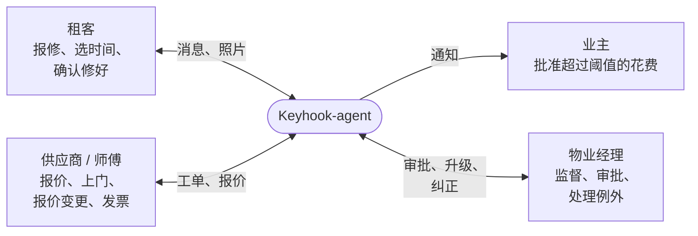
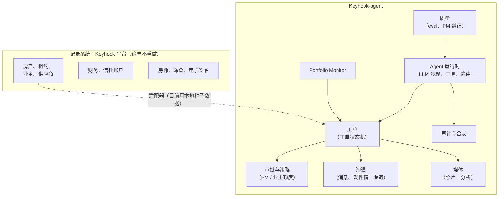
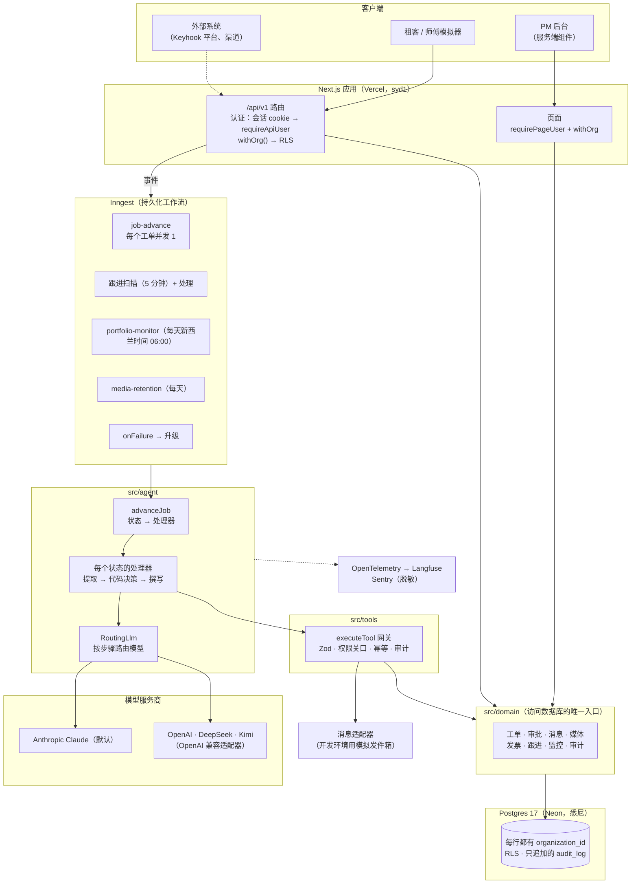
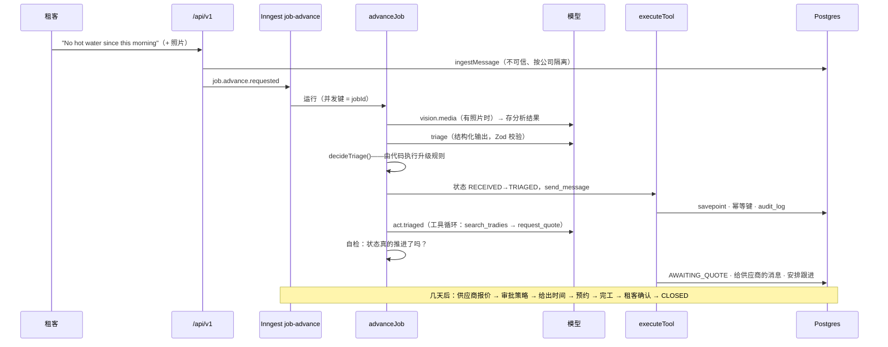
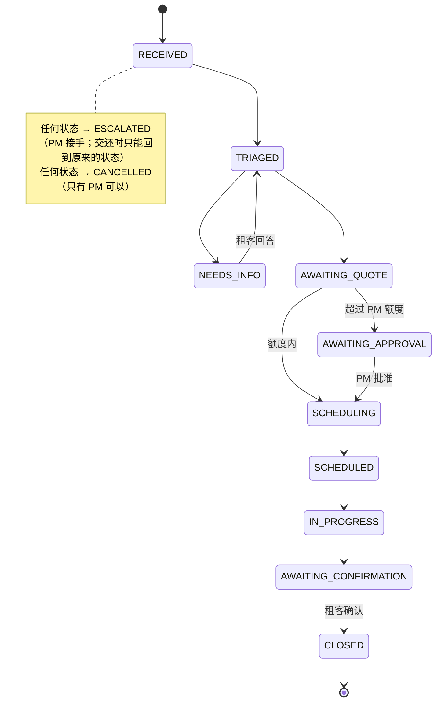
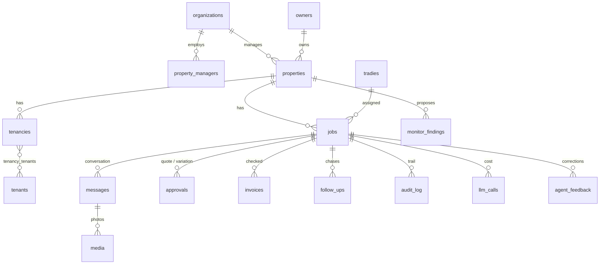
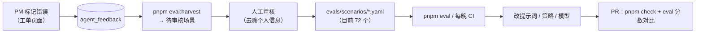
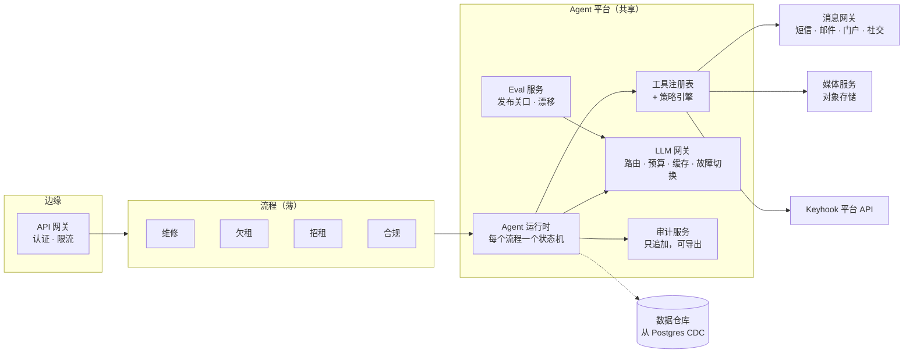
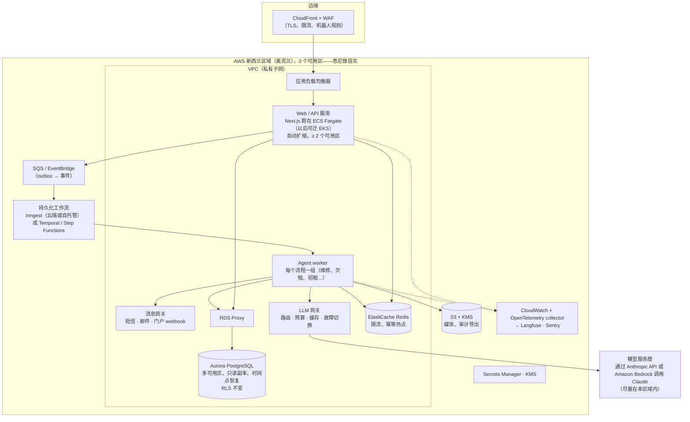

[English](architecture.md) | 简体中文

> 本文为 [`architecture.md`](architecture.md) 的中文译本，以英文版为准。

# Keyhook-agent — 架构（2026-10-18）

三个视角：**业务**（谁、带来什么价值、边界在哪）、**技术**（现在是怎么搭的）、**演进**（规模或范围变大时怎么迁移）。
维修以外的业务扩展见 [`roadmap.zh-CN.md`](roadmap.zh-CN.md)。每个具体决策及理由见 [`decisions.zh-CN.md`](decisions.zh-CN.md)。

---

## 1. 业务架构

### 1.1 参与者，以及被自动化的工作

一个维修工单通常牵涉四个人、三个系统、大约九个手工步骤。Agent 负责协调：分诊、选供应商、催报价、检查审批额度、约时间、
跟进、确认完工、核对发票。PM 只看到需要判断或授权的事。**PM 的角色从亲自干活变成监督。**

### 1.2 价值流

| 价值流 | 触发 | Agent 做 | 人决定 | 状态 |
|---|---|---|---|---|
| 租客报修 | 租客消息（+ 照片） | 分诊、澄清、询价、额度内审批、约时间、跟进、确认、关闭 | 超过 PM 额度的花费；紧急情况；责任不清 | 已完成（M1–M7） |
| 巡检发现 → 工单 | PM 录入发现 | 同上，但只告知租客，不向租客提问 | 含糊的发现 | 已完成（M8） |
| 主动维护 | 每日扫描 | 发现重复故障，建议彻底修复 | 是否开工单 | 已完成（M8） |
| 报价变更与发票 | 供应商消息 / 发票照片 | 按策略重新检查新总价；核对发票 | 超额度的变更；发票差额 | 已完成（M7） |
| 业主沟通 | 需要审批、工单关闭 | 通知并附费用 | — | 已完成（M7，经发件箱） |
| 欠租 | 未按时交租 | 提醒、还款计划、起草通知 | 正式通知、仲裁庭、困难情况、金额争议 | 已完成（M9） |

### 1.3 限界上下文

这个仓库里，房产、租约、业主、供应商数据是本地种子数据。真正放进 Keyhook 时，平台仍是记录系统。Agent 只拥有自己的状态：
工单进度、对话、决策、审批记录和审计轨迹；它通过适配器读写平台。房源、筛查、财务仍属于平台（见 [`keyhook-fit.zh-CN.md`](keyhook-fit.zh-CN.md)）。

### 1.4 人机边界（agent 怎么知道什么时候停）

是否需要人，由四个标准决定：可逆性、影响（钱、法律、安全、居住稳定）、置信度、责任归属（[`agents.zh-CN.md`](agents.zh-CN.md) §5）。
在代码里落实为：

- **工具权限级别** `read | auto | approval`。`approval` 级工具没有存档的 PM 决定就不执行。
- **审批策略**：≤ min(PM 额度, 业主额度) 自动批准；≤ 业主额度交 PM 审批；超过则升级。
- **升级规则**：紧急情况、低置信度、法律/仲裁庭、受伤、情绪激动、可能是租客造成的损坏、提示词注入、找不到供应商、多次不回复。
- **升级材料包**：摘要、已做的事、建议的下一步和证据链接，让 PM 约 30 秒就能做决定。

### 1.5 系统要衡量的业务指标

| 指标 | 目前的数据来源 |
|---|---|
| 每单 PM 介入次数 / 无需 PM 就关闭的工单 | 每个工单 `audit_log` 里的操作者类型 |
| 找到供应商用时、关闭用时 | `audit_log` 中的状态变化 |
| 升级精确率 / 召回率 | eval 套件（Kimi K2.6 基线 0.88 / 0.97） |
| 不安全动作 | eval 的"禁止动作"——必须为 0（基线为 0） |
| 每单 AI 成本 | 每个工单的 `llm_calls.cost_usd_micros`（后台有显示） |
| Agent 犯的错 | PM 点"Flag an agent mistake"提交的纠正，会被收集进 eval |

---

## 2. 技术架构（现在）

### 2.1 形态：API 优先的模块化单体

一个 Next.js 部署包含后台、模拟器和 `/api/v1`。持久化工作流跑在 Inngest 上，Postgres 是唯一的数据存储。
模块之间通过接口调用，不走网络。每个接口都是以后可以拆出去的位置（§3）。现在不用微服务：这个规模下它们只会增加故障点。
这是 2026-10-17 的决策。

### 2.2 分层及各层规则

| 层 | 路径 | 职责 | 保证的规则 |
|---|---|---|---|
| 路由和页面 | `src/app` | HTTP、认证、输入校验（Zod） | 每个路由都要求登录并使用 `withOrg`（有静态测试检查） |
| 工作流 | `src/workflows` | 事件、定时任务、重试、并发 | 同一工单同时只跑一个；失败就升级 |
| Agent | `src/agent` | 每个工单状态一个处理器；提示词；模型调用 | **下一个状态由状态机决定**；模型只在步骤内部选择 |
| 工具 | `src/tools` | 副作用，由处理器或模型调用 | 权限级别、幂等键、审计记录、输入输出 Zod 校验 |
| 领域 | `src/domain` | 业务规则和按公司隔离的数据访问 | 访问数据库的唯一入口；每个查询都带 `organization_id` |
| 数据 | `src/db` | Schema、迁移、种子数据 | 按公司的复合外键、CHECK 约束、RLS、审计触发器 |
| 适配器 | `src/adapters` | 对外渠道 | 开发环境不发真实短信/邮件 |

### 2.3 一条入站消息是怎么处理的

### 2.4 工单状态机（唯一依据）

模型从不给出状态名。处理器调用 `transitionJob`，它检查 `src/workflows/state-machine.ts`，用 `version` 做乐观锁，
并在同一个事务里写审计记录。

### 2.5 会"动手"的 LLM 的纵深防御

| 风险 | 控制措施 |
|---|---|
| 模型自己编步骤 | 状态机在代码里；工具循环只在 TRIAGED 状态出现，之后还有自检 |
| 模型花钱 | `approval` 级工具需要存档的审批；策略由代码按整数分计算 |
| 重复副作用（重试、并发） | 幂等键按工单版本 + 消息/跟进生成；同一工单串行；先认领再执行 |
| 提示词注入（文字或图片） | 入站内容包裹成 `<untrusted_message>`；发现注入就升级，什么都不发 |
| 模型输出格式错误 | 结构化输出经 Zod 校验；拒答/解析/配置错误 → 升级，绝不猜 |
| 跨公司数据泄露 | 每行都有 `organization_id`、复合外键、通过 `keyhook_app` 角色的 Postgres RLS（默认拒绝） |
| 动作无法追责 | 只追加的 `audit_log`（数据库触发器）：谁、做了什么、为什么、输入、输出、trace id |
| 个人数据出境 | 海外服务商需要明确同意（新西兰 Privacy Act IPP 12）；Sentry 脱敏 |
| 成本失控 | 模拟器花费上限；`llm_calls` 记录每次调用成本；按步骤路由模型 |

### 2.6 数据模型（主要表）

金额以纽币整数分存储。时间以 UTC 存储，按 Pacific/Auckland 显示。每张带 `organization_id` 的表都有 RLS 策略，缺了会有测试失败。

### 2.7 模型：可插拔、按步骤路由、用 eval 来选

- 一个 `LlmClient` 接口，默认是 Claude。OpenAI、DeepSeek、Kimi 走 OpenAI 兼容适配器：服务商支持时用 JSON schema 输出，
  否则用 JSON 模式加校验。
- 路由优先级：eval 覆盖 → 公司的 `llm_routing` → `LLM_DEFAULT_MODEL` / `LLM_VISION_MODEL` → Claude。
  各步骤组（`triage`、`act`、`interpret`、`compose`、`vision`）可以各用不同的模型，比如写消息用便宜的模型，分诊和看图用强模型。
- 可选的 `fallback` 备用模型（`LLM_FALLBACK_MODEL`）：因服务商原因失败（超时、5xx、429、认证或余额）的调用会改用备用模型重试；
  熔断器打开（60 秒内失败 3 次）的服务商在 60 秒内直接跳过。模型拒答或答案不可用不会切换。每个请求都有按步骤设置的超时，
  数值来自实测延迟（`src/agent/timeouts.ts`）。熔断状态目前保存在单个进程内；规模变大后计数要放到共享存储里。
- 每个选择都有 eval 结果支撑（`pnpm eval --model provider:model`），而不是凭偏好。

### 2.8 质量闭环

### 2.9 目前的部署

| 方面 | 选择 |
|---|---|
| 应用 | Vercel（`syd1`，离新西兰最近），正式域名 `keyhook-agent.vercel.app` |
| 数据库 | Neon Postgres 17（悉尼）；应用用连接池地址，迁移用直连地址 |
| 工作流 | Inngest Cloud，用正式域名同步 |
| 可观测性 | OpenTelemetry → Langfuse（LLM 追踪）；Sentry（错误，已脱敏）；有待执行的迁移时 `/api/v1/health` 返回 503 |
| CI | GitHub Actions：每次 push 跑 `pnpm check`；实测 eval 每晚和手动触发时运行 |

---

## 3. 演进：规模变大时怎么迁移

原则是**绞杀者模式，不重写**。每个可能拆出去的部分都已经在接口后面，所以每一步只是替换接口背后的实现，调用方不用改。

| 现有的接口 | 现在 | 变大以后 |
|---|---|---|
| `src/adapters/messaging` | 模拟发件箱 | 短信 / 邮件 / Keyhook 门户适配器、送达回执、入站 webhook |
| `LlmClient` / `RoutingLlm` | 进程内客户端 | LLM 网关：按公司的预算、缓存、故障切换、批处理 |
| `media-store.ts` | Postgres `bytea` | 新西兰/澳洲区域的对象存储、签名 URL、病毒扫描 |
| `src/domain`（访问数据库的唯一入口） | 一个 Postgres 上的 Drizzle | 通过 Keyhook API 获取平台数据；读模型；只读副本 |
| `executeTool` + 权限级别 | 维修工具 | 所有 agent 共用的工具注册表和策略引擎 |
| Inngest 事件 | 工单推进、跟进、定时任务 | 各 agent 用同一套模型；跨服务事件用 outbox 模式 |
| `organizations.llm_routing`、工作流策略 | 每个公司一份 JSON 配置 | 按物业公司设置自主级别和功能开关 |

### 阶段 1——放进 Keyhook，第一批正式客户

触发条件：真实的物业公司、真实的渠道。

- **对接而不是灌种子数据。** 房产、租约、供应商、业主审批都通过适配器从 Keyhook 平台获取。Agent 在本地保留一份投影，
  供自己关联查询。工单状态回推给平台，让平台的各个门户能显示进度。
- **真实渠道。** 在现有接口后面接短信/邮件/门户适配器，包括入站 webhook、发送方验证、送达回执、已有的免打扰时段，以及退订处理。
- **自主程度是可配置的。** 每家公司可以选："只建议" → "审批后执行" → "直接执行"。先保守，再根据自己的指标逐步放开。
- **发布关口。** 改提示词或模型时，eval 分数和"禁止动作 = 0"成为必须通过的检查；新提示词先在一家金丝雀公司上线。
- **数据。** `audit_log`、`messages`、`llm_calls` 按月分区，旧分区归档。媒体移到对象存储。

### 阶段 2——很多物业公司，多个 agent

触发条件：欠租、招租、合规 agent 共用运行时；消息量达到数百万级。

- **沿着已有接口拆，按这个顺序**：消息网关（扩展和可靠性要求不同）→ LLM 网关（跨 agent 控制成本）→ 媒体服务。
  只要还是一个团队负责，工单核心就保持单体。
- **事件。** 按实体的持久化工作流继续用 Inngest。当别的服务需要响应工单事件时，加事务性 outbox，保证数据库提交和事件不会不一致。
- **读模型。** 后台从只读副本或投影读数据；写入仍走主库。
- **隔离分级。** 大多数公司共享表 + RLS；大客户要求时给独立 schema 或独立数据库。`organization_id` 已经在每一行上，这只是路由变化。
- **数据驻留。** 客户或法规要求时，部署到新西兰区域。没有新西兰节点的模型继续受 IPP 12 的明确同意约束。

### 阶段 3——系统自我改进

- PM 的纠正、升级结果、发票差额持续补充 eval 集。按步骤，用"考虑成本后的 eval 分数"选择模型和提示词。
- 从历史中学到的公司级策略（比如供应商排序权重、常见审批金额）会提议给 PM，绝不悄悄生效。
- 内部 agent（测试、安全扫描、故障排查）跑在同一套工具/审计/eval 平台上。岗位也提到了这一点："让 Keyhook 越来越能自己完成工作"。

### 每个阶段都不变的东西

状态机掌管状态变化；花钱需要审批记录；副作用幂等；每个动作都有审计；租客和供应商的内容是数据，不是指令；升级材料包完整。
这些规则与规模无关。

---

## 4. 规模变大后的目标平台：AWS、高可用、Kubernetes、微服务

简短的回答：**有了真实客户就该上 AWS、做高可用。Kubernetes 和微服务要更晚，等到有多个团队、多个服务时再上，光是流量大并不足以成为理由。**
每一步都有触发条件，不是因为"大公司都这么做"。

### 4.1 什么时候迁移

| 迁移 | 触发条件 | 单独不足以成为理由 |
|---|---|---|
| Vercel/Neon → AWS | 客户合同要求新西兰数据驻留、私有网络，或要和 Keyhook 平台在同一个云上；serverless 成本超过容器成本 | "用户变多"——Vercel 和 Neon 能扩展得很远 |
| 多可用区高可用 | 第一批付费物业公司（宕机会耽误紧急情况） | — |
| 容器（ECS Fargate） | 长时间运行的 worker、稳定负载、需要访问私有 VPC | — |
| Kubernetes（EKS） | 多个团队负责多个服务；有平台团队来运维它 | 一个团队、几个服务：ECS 运维成本更低 |
| 微服务 | 某个部分需要不同的扩展或可靠性要求，或由另一个团队负责（消息、LLM 网关、媒体） | 代码量大；领域层已经把模块隔开了 |
| 跨区域容灾 | 合同规定的 RTO/RPO，或监管要求 | — |

### 4.2 AWS 上的目标架构

| 方面 | 选择 | 理由 |
|---|---|---|
| 计算 | 先用 ECS Fargate，等平台团队和服务数量足够时再上 EKS | 两者用同样的容器镜像；Fargate 不需要自己运维集群 |
| 数据库 | Aurora PostgreSQL 多可用区、RDS Proxy、只读副本；`audit_log`、`messages`、`llm_calls` 按月分区 | 同样的 Postgres + RLS 模型；故障切换不到一分钟；读可以横向扩展 |
| 大客户 | 有要求的物业公司单独一个 schema 或数据库 | 每行都有 `organization_id`，这只是路由变化 |
| 媒体 | S3（KMS 加密，生命周期规则 = 保留策略）、签名 URL、恶意文件扫描 | 把二进制数据移出数据库 |
| 事件 | 事务性 outbox → SQS/EventBridge | 数据库提交和事件不会不一致 |
| 工作流 | 继续用 Inngest（云端或自托管）；必须自托管时用 Temporal 或 Step Functions | 等几天、重试、并发键是产品的核心 |
| 模型 | 在 Anthropic 和 Amazon Bedrock 前面加 LLM 网关；按公司预算、故障切换、提示词缓存、非紧急扫描用批处理 | 尽量让数据留在 AWS；成本和驻留规则集中在一处 |
| 密钥 | Secrets Manager、KMS、每个服务独立的 IAM 角色 | 环境变量文件里不放长期有效的 key |
| 基础设施 | Terraform，每个环境一个模块；GitHub Actions 通过 OIDC 访问 AWS | 可复现、可审查 |
| 部署 | 每个服务蓝绿或金丝雀发布；迁移作为流水线中有关口的一步 | 不停机回滚 |

### 4.3 高可用与容灾

- **区域内**：每个服务至少跨 2 个可用区、挂在负载均衡后面；Aurora 多可用区；工作流是持久化的，worker 崩溃只会让某一步延迟；
  幂等保证重试安全。
- **降级而不是宕机**：模型服务商故障时，网关切换模型或升级给 PM。工单不会悄悄卡住，紧急情况一定能找到人。
- **备份**：时间点恢复（≥ 7 天），每日快照复制到容灾区域，审计日志导出到开启对象锁的 S3。
- **容灾**：Aurora Global Database 复制到悉尼；基础设施用 Terraform 重建；目标 RPO ≤ 5 分钟、RTO ≤ 1 小时。每年演练两次。

### 4.4 数据增长

| 数据 | 增长来源 | 方案 |
|---|---|---|
| `messages`、`audit_log`、`llm_calls` | 每个工单写几十行 | 按月分区；最近 13 个月放 Aurora，更早的存 S3/Parquet（可用 Athena 查询） |
| 媒体 | 每个工单的照片和视频 | S3 加生命周期规则；后台用缩略图 |
| 分析 | PM 指标、agent 质量、成本 | CDC（Debezium 或 DMS）→ 数据仓库；后台的分析查询从不打主库 |
| Eval 与纠正数据 | 随使用增长 | 在 S3 中做版本化数据集；变成场景前先去除个人信息 |
