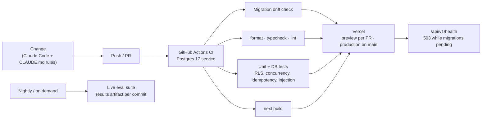

English | [简体中文](operations.zh-CN.md)

# Operations: CI/CD, observability and automation (2026-10-18)

What runs automatically today, what a person still does by hand, and what gets automated as the
system grows. The architecture this supports is in [`architecture.md`](architecture.md).

## 1. Delivery pipeline today

| Stage | Automated | How |
|---|---|---|
| Code rules | ✅ | ESLint (strict type-aware), Prettier, TypeScript strict; `pnpm check` runs all of them |
| Schema ↔ migration drift | ✅ | CI regenerates migrations and fails if the schema changed without one |
| Tests against a real database | ✅ | CI starts Postgres 17, migrates and seeds, then runs the 260+ tests |
| Security invariants as tests | ✅ | Static route guard (every route authenticates and uses `withOrg`); RLS on every org table; injection and idempotency tests |
| Build and deploy | ✅ | Vercel builds every push; `main` goes to production in `syd1` |
| Finding new failures | ✅ (on demand) | `pnpm redteam`: a model writes adversarial cases, the real agent runs them, rules + a judge score them; failures become unreviewed scenarios |
| Model quality | ✅ (nightly) | `eval.yml`: live scenarios, forbidden actions must be 0, results uploaded per commit |
| Database migrations in production | ⚠️ manual | `pnpm exec tsx --env-file=.env.neon.local src/db/migrate.ts`; health returns 503 until done |
| Inngest function sync | ⚠️ manual | Resync in the Inngest dashboard when functions are added |

## 2. Runtime automation (the system keeps itself going)

| Concern | Mechanism |
|---|---|
| Waiting days for replies | Inngest durable workflows; follow-ups stored in the DB, swept every 5 minutes, claimed before acting |
| Retries without duplicates | Per-job concurrency 1; idempotency keys per job version and triggering message |
| Failures | `onFailure` escalates the job to a PM with the error instead of failing silently |
| Bad model output / provider outage | Zod validation; permanent provider errors (auth, billing) escalate immediately, transient ones retry |
| Data retention | Daily cron deletes photos past 180 days |
| Proactive work | Daily Portfolio Monitor scan per organization |
| Cost control | Every model call recorded with tokens and cost (`llm_calls`); daily budget and simulator rate limits |

## 3. Observability

| Signal | Tool | What it answers |
|---|---|---|
| LLM traces | OpenTelemetry → Langfuse (GenAI semantic conventions) | Which prompt, model, tokens, latency, cost per step and job |
| Errors | Sentry (server-side, personal data scrubbed in `beforeSend`) | What broke, with the trace id |
| Business audit | `audit_log` (append-only, DB trigger) | Who did what and why, per job; the PM can read it in the dashboard |
| Health | `/api/v1/health` | Database reachable, migrations applied |
| Quality | Eval results per commit; PM corrections page | Is the agent getting better or worse? |

## 4. Engineering with AI, under rules

The code is written with Claude Code, inside guardrails that make AI-written changes reviewable:

- `CLAUDE.md`: non-negotiable rules covering the state machine, permissions, idempotency, audit,
  untrusted input, money and dates.
- "Done" means `pnpm check` is green; agent changes also need an eval run.
- Each architecture decision is recorded with a date and a reason (40+ entries).
- The PM correction loop turns production mistakes into regression scenarios.

The role describes the same thing for Keyhook's own engineering: AI does the work, and the
system checks the AI.

How a small team hands more of this pipeline to agents, stage by stage:
[`ai-delivery.md`](ai-delivery.md).

## 5. Next automation steps (in order)

| Step | Why | Sketch |
|---|---|---|
| Automated production migrations | Remove the manual step that caused a 500 once | GitHub Action on `main`: migrate Neon with the direct URL secret, then promote the deployment; health gate |
| Inngest sync on deploy | Remove the second manual step | Call the Inngest sync endpoint after the production deployment succeeds |
| Eval as a release gate | Stop prompt regressions before production | Run the affected scenarios on every PR that touches `src/agent`, `src/tools` or prompts; block on forbidden actions or a score drop |
| Dependency and code scanning | Supply chain | Dependabot / Renovate, CodeQL, `pnpm audit` in CI |
| Alerting | Know before a PM does | Alerts on escalation-rate spikes, eval drops, provider error rate, stuck jobs (no progress past the SLA), daily cost |
| Infrastructure as code | Reproducible environments | Terraform for the AWS target ([`architecture.md`](architecture.md) §4); today's Vercel/Neon/Inngest settings in code |
| Load and chaos tests | Know the limits | k6 against the API and workflow throughput; inject provider timeouts and DB failovers |
| Runbooks | On-call can act fast | Stuck job, provider outage (switch model routing), migration rollback, data request under the Privacy Act |

## 6. Service levels to aim for (production)

| SLI | Target |
|---|---|
| Inbound message → agent reply (P95, excluding provider outages) | < 60 s |
| Emergency → PM notified | < 2 min |
| Forbidden actions in production | 0 (any occurrence is an incident) |
| API availability | 99.9 % monthly |
| Recovery point / time objective | ≤ 5 min / ≤ 1 h |
