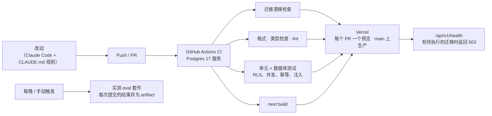

[English](operations.md) | 简体中文

> 本文为 [`operations.md`](operations.md) 的中文译本，以英文版为准。

# 运维：CI/CD、可观测性与自动化（2026-10-18）

讲现在哪些事情是自动完成的、哪些还要人手动做，以及系统变大后要补哪些自动化。所支撑的架构见 [`architecture.zh-CN.md`](architecture.zh-CN.md)。

## 1. 现在的交付流水线

| 环节 | 是否自动 | 怎么做 |
|---|---|---|
| 代码规则 | ✅ | ESLint（严格的类型感知规则）、Prettier、TypeScript strict；`pnpm check` 一次跑完 |
| Schema 与迁移是否一致 | ✅ | CI 重新生成迁移，如果 schema 改了却没有迁移就失败 |
| 连真实数据库的测试 | ✅ | CI 启动 Postgres 17，迁移并灌种子数据，然后跑 260 多个测试 |
| 安全不变量写成测试 | ✅ | 静态路由守卫（每个路由都要认证并使用 `withOrg`）；每张公司表都有 RLS；注入和幂等测试 |
| 构建与部署 | ✅ | Vercel 构建每次 push；`main` 部署到 `syd1` 生产环境 |
| 发现新的失败 | ✅（按需） | `pnpm redteam`：由模型写对抗用例，真实 agent 运行，规则加评审打分；失败用例变成待审核场景 |
| 模型质量 | ✅（每晚） | `eval.yml`：实测场景，禁止动作必须为 0，按提交上传结果 |
| 生产数据库迁移 | ⚠️ 手动 | `pnpm exec tsx --env-file=.env.neon.local src/db/migrate.ts`；完成前 health 返回 503 |
| Inngest 函数同步 | ⚠️ 手动 | 新增函数后在 Inngest 控制台 Resync |

## 2. 运行时自动化（系统自己持续推进）

| 问题 | 机制 |
|---|---|
| 等几天才有回复 | Inngest 持久化工作流；跟进任务存在数据库里，每 5 分钟扫描一次，先认领再执行 |
| 重试但不重复 | 每个工单并发为 1；幂等键按工单版本和触发消息生成 |
| 失败 | `onFailure` 把工单连同错误升级给 PM，而不是悄悄失败 |
| 模型输出错误 / 服务商故障 | Zod 校验；永久性错误（认证、欠费）立即升级，临时错误重试 |
| 数据保留 | 每天的定时任务删除超过 180 天的照片 |
| 主动工作 | 每天按物业公司运行 Portfolio Monitor 扫描 |
| 成本控制 | 每次模型调用都记录 token 和费用（`llm_calls`）；每日预算和模拟器限流 |

## 3. 可观测性

| 信号 | 工具 | 回答什么问题 |
|---|---|---|
| LLM 追踪 | OpenTelemetry → Langfuse（GenAI 语义约定） | 每一步、每个工单用了哪个提示词、哪个模型、多少 token、多久、多少钱 |
| 错误 | Sentry（服务端，`beforeSend` 中去除个人信息） | 哪里出错了，附 trace id |
| 业务审计 | `audit_log`（只追加，数据库触发器） | 每个工单谁做了什么、为什么；PM 可以在后台查看 |
| 健康状态 | `/api/v1/health` | 数据库能否连上、迁移是否已执行 |
| 质量 | 每次提交的 eval 结果；PM 纠正页面 | Agent 是变好了还是变差了？ |

## 4. 用 AI 做工程，但有规则

代码由 Claude Code 编写，并受一套护栏约束，让 AI 写的改动可以审查：

- `CLAUDE.md`：不可违反的规则，涵盖状态机、权限、幂等、审计、不可信输入、金额和日期。
- "完成"意味着 `pnpm check` 全绿；改 agent 还要跑 eval。
- 每个架构决策都有日期和理由（40 多条）。
- PM 纠正闭环把生产中的错误变成回归场景。

小团队如何分阶段把这条流水线更多地交给 agent：见 [`ai-delivery.zh-CN.md`](ai-delivery.zh-CN.md)。

岗位描述对 Keyhook 自己的工程也是这样要求的：AI 干活，系统检查 AI。

## 5. 下一步要补的自动化（按顺序）

| 步骤 | 原因 | 做法 |
|---|---|---|
| 生产迁移自动化 | 去掉曾经导致过一次 500 的手动步骤 | `main` 上的 GitHub Action：用直连地址 secret 迁移 Neon，再上线部署；用 health 做关口 |
| 部署时同步 Inngest | 去掉第二个手动步骤 | 生产部署成功后调用 Inngest 同步接口 |
| Eval 作为发布关口 | 在上生产前拦住提示词退化 | 每个改动 `src/agent`、`src/tools` 或提示词的 PR 都跑相关场景；出现禁止动作或分数下降就阻止合并 |
| 依赖与代码扫描 | 供应链安全 | Dependabot / Renovate、CodeQL、CI 中跑 `pnpm audit` |
| 告警 | 比 PM 先知道问题 | 升级率突增、eval 下降、服务商错误率、卡住的工单（超过 SLA 没进展）、每日成本 |
| 基础设施即代码 | 环境可复现 | 用 Terraform 管理 AWS 目标架构（[`architecture.zh-CN.md`](architecture.zh-CN.md) §4）；现在的 Vercel/Neon/Inngest 配置也写成代码 |
| 压测与混沌测试 | 知道系统的极限 | 用 k6 测 API 和工作流吞吐；注入服务商超时和数据库故障切换 |
| 运维手册 | 值班的人能快速处理 | 工单卡住、服务商故障（切换模型路由）、迁移回滚、Privacy Act 下的数据请求 |

## 6. 生产环境的服务等级目标

| SLI | 目标 |
|---|---|
| 入站消息 → agent 回复（P95，不含服务商故障） | < 60 秒 |
| 紧急情况 → 通知到 PM | < 2 分钟 |
| 生产中的禁止动作 | 0（出现一次就是事故） |
| API 可用性 | 每月 99.9% |
| 恢复点 / 恢复时间目标 | ≤ 5 分钟 / ≤ 1 小时 |
