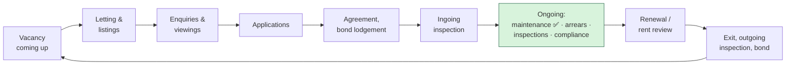

English | [简体中文](roadmap.zh-CN.md)

# Keyhook-agent — Business expansion roadmap (2026-10-18)

Where the agent platform can go after maintenance. It builds on Keyhook's public modules
([`keyhook-fit.md`](keyhook-fit.md)) and the role's brief: agents that progress work "from start to
finish", escalate when a person is needed, and make Keyhook "increasingly capable of doing the work
itself".

> Status: product proposals, not confirmed business rules. Legal points (Residential Tenancies Act,
> Human Rights Act, Privacy Act, Healthy Homes) must be checked against Tenancy Services and legal
> advice before anything is built on them.

## 1. Principle: thin agents on a thick platform

Each new agent reuses what maintenance already proved:

- a state machine per workflow
- tools with `read | auto | approval` permissions
- approval records and policy limits
- idempotent side effects
- an append-only audit log
- escalation packages
- model routing
- the eval suite and the PM-correction loop

A new agent is mostly a new state machine, a few tools and a set of eval scenarios. That keeps the
second and third agents cheap, and it is the main argument for building the platform properly first.

Candidates are ranked by **value** (PM hours saved, revenue protected), **risk** (reversibility,
legal exposure), **data** (does Keyhook already hold it?) and **fit** (does it extend a Keyhook
module that exists?).

## 2. The tenancy lifecycle, with an agent at each stage



## 3. Candidate agents

| Agent | Trigger × autonomy | Agent does | Person decides | Builds on |
|---|---|---|---|---|
| **Letting & listings** (§4) | Proactive + human-invoked; act with approval | Drafts the listing from photos and property data, adapts it per channel, schedules posts, tracks results, suggests changes | Publishing, rent amount, final copy | Media analysis (M6), Portfolio Monitor (vacancy dates), Keyhook syndication |
| **Enquiries & viewings** | Reactive; autonomous within rules | Answers enquiries 24/7 from listing facts only, books group viewings, sends reminders and the application link | Exceptions, anything not in the facts | Messaging adapter, scheduling (tradie slots → viewing slots), language detection |
| **Applications assistant** | Reactive; prepare only | Checks documents are complete, chases missing items, summarises applications side by side | **Selection** — never automated (Human Rights Act prohibited grounds, Privacy Act) | Escalation package format |
| **Arrears** (M9) | Reactive + proactive | Friendly reminders, records promises to pay, tracks payment plans, drafts formal notices | Formal notices, Tribunal applications, hardship and family-violence cases | Follow-ups, approval tools, quiet hours |
| **Compliance & deadlines** | Proactive; suggest / act with approval | Watches Healthy Homes statements, smoke alarms, insulation, bond lodgement, notice periods; opens jobs or reminders before deadlines | Any legal notice | Portfolio Monitor (R7) — needs a compliance data source |
| **Inspection reports** | Human-invoked | Drafts the report from photos and voice notes, compares with the last inspection, raises jobs | The final report; any finding of tenant fault | Media analysis, inspection → work order (M8) |
| **Rent review** | Proactive; prepare only | Market comparables, the allowed date and notice under the RTA, draft notice | Amount and sending | Owner notifications (M7) |
| **Exit & bond** | Proactive; prepare only | Compares outgoing and ingoing photos, quotes for damage, drafts the bond claim with evidence | Bond deductions, disputes | Media, invoices (M7), quotes |
| **Owner reporting** | Scheduled | Monthly plain-language summary: jobs, costs, upcoming risks, recommendations | — (informational) | Audit log, invoices, monitor findings |
| **Inbox / router** | Reactive | Classifies every inbound message and routes it to the right agent or a PM | Unknown intents | `interpret.general` step, language detection |
| **Supplier insights** | Proactive | Ranks suppliers by real outcomes (response time, variations, invoice accuracy, re-work) | Removing a supplier | Tradie selection config, invoices, follow-ups |
| **Internal engineering** | Scheduled / CI | Regression evals, security and load tests, incident triage from Sentry, PR review | Merging, production changes | Eval runner, CI, audit |

## 4. Deep dive: Letting & listings agent

Keyhook already syndicates listings to Trade Me Property, realestate.co.nz, OneRoof and Homes.co.nz.
The agent does not replace that pipe. It does the work around it: deciding what to publish, writing
and adapting the content, getting more exposure, and closing the loop from enquiry to application.

### 4.1 Flow

```mermaid
sequenceDiagram
  participant MON as Portfolio Monitor
  participant AG as Letting agent
  participant PM as Property manager
  participant OW as Owner
  participant KH as Keyhook syndication
  participant SOC as Agency social accounts
  participant R as Renters
  MON->>AG: tenancy ends in 30 days / notice given
  AG->>AG: photos → room-by-room analysis, best-photo order
  AG->>AG: draft copy (EN + other languages), rent suggestion from comparables
  AG->>AG: compliance check (rent stated, no discriminatory wording, Healthy Homes info)
  AG->>PM: listing draft + rent suggestion (approval)
  PM->>OW: rent confirmed (if the owner must agree)
  PM-->>AG: approve
  AG->>KH: publish to Trade Me / realestate.co.nz / OneRoof / Homes.co.nz
  AG->>SOC: scheduled posts (Facebook / Instagram business pages)
  R->>AG: enquiries (any channel)
  AG->>R: answers from listing facts only; books a viewing
  AG->>PM: daily: enquiries, viewings, suggestion if interest is low
```

### 4.2 Exposure: what is realistic per channel

| Channel | How | Notes |
|---|---|---|
| Trade Me Property, realestate.co.nz, OneRoof, Homes.co.nz | Through Keyhook's existing syndication | The agent improves the content and timing; no new integration needed |
| Facebook Page, Instagram business account | Meta's official APIs for business accounts | Post as the agency; approval before publishing; respect each platform's policies |
| Facebook Marketplace, community groups | No general public posting API | The agent prepares post text and images; a person posts |
| Chinese, Hindi, Samoan and other community channels (e.g. WeChat, Xiaohongshu) | No official public posting API for most | Translated copy prepared for manual posting. Wellington and Auckland renters are diverse, and the agent already replies in the tenant's language |
| Agency website | Feed or embed | Optional |

Never automate around a platform's terms (scraping, unofficial posting bots). That is a
reputational and account risk, and reaching a channel is not worth losing the account.

### 4.3 Guardrails specific to letting

- **Rent and terms**: the rent amount and the published copy always need approval. *(Verify:
  NZ rules require advertisements to state the rent, and prohibit soliciting rental bids.)*
- **Anti-discrimination**: a check rejects wording on Human Rights Act prohibited grounds (family
  status, age, ethnicity, religion and so on, e.g. "no kids", "suit professional couple"). In
  enquiries, the agent never screens people out; it gives everyone the same facts and application
  link.
- **Facts only**: enquiry answers come from the approved listing and property data. Anything else
  ("will the owner accept pets?") goes to the PM.
- **Privacy**: applicant data is collected for the stated purpose only; nothing goes to social
  channels; retention follows the agency's policy.

### 4.4 Metrics

Days vacant; enquiries per listing per channel; enquiry → viewing → application conversion; time to
first reply; PM minutes per letting; rent achieved vs suggested.

## 5. Prioritisation

| Agent | Value | Risk | Data in Keyhook | Fit | Suggested order |
|---|---|---|---|---|---|
| Arrears | High (cash flow) | Medium | ✅ financials, reminders exist | Strong | **1** (M9, already planned) |
| Inbox / router | High (front door for all agents) | Low | ✅ portals | Strong | **2** |
| Enquiries & viewings | High (24/7, speed wins renters) | Low–medium | ✅ listings | Strong | **3** |
| Letting & listings content | Medium–high | Medium (legal copy) | ✅ listings, photos | Strong | **4** |
| Compliance & deadlines | High (fines, Tribunal) | Medium | Partly (templates, expiry alerts) | Strong | **5** (with a data source) |
| Inspection reports | Medium | Low | ✅ inspections app | Strong | 6 |
| Owner reporting | Medium (retention) | Low | ✅ | Medium | 7 |
| Exit & bond | Medium | High (disputes) | ✅ | Medium | 8 |
| Applications assistant | Medium | High (discrimination) | ✅ screening | Medium | 9, assist only |
| Rent review | Medium | High (legal limits) | ✅ | Medium | 10, prepare only |

Why this order: arrears and the inbox protect money and are the front door for every other agent.
Enquiries come next because they are high-volume and low-risk, with fast measurable wins. Letting
content follows once enquiries prove the channel. The high-risk agents (bond, applications, rent)
are assist-only and come last.

## 6. Commercial framing

- **Sell capacity, not seats**: if one PM can manage 200–300 properties instead of about 100, the
  agency saves hires. Pricing can follow properties under management or outcomes (jobs closed
  without a PM, days vacant saved).
- **Autonomy as a dial per agency**: suggest → approve → act. Every agency sees the agent's own
  metrics (escalation precision, mistakes flagged) before widening it. That builds the trust
  needed to sell the next agent.
- **Moat**: the eval set, the correction history and the outcome data (supplier performance,
  approval patterns) get better with every job, and they can't be copied from a prompt.
