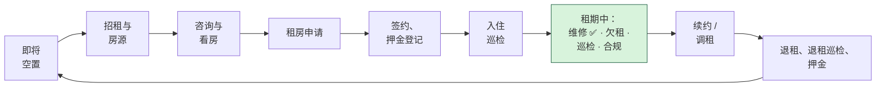
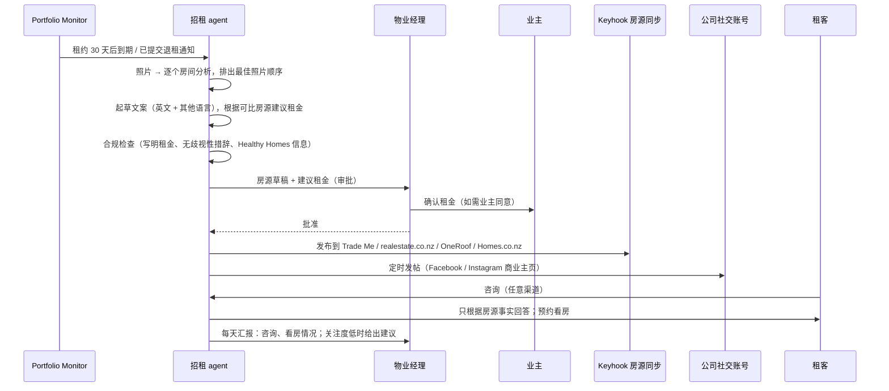

[English](roadmap.md) | 简体中文

> 本文为 [`roadmap.md`](roadmap.md) 的中文译本，以英文版为准。

# Keyhook-agent — 业务扩展路线图（2026-10-18）

讲维修之后，这套 agent 平台还能往哪里走。基础是 Keyhook 网站上公开的模块（[`keyhook-fit.zh-CN.md`](keyhook-fit.zh-CN.md)）
和岗位描述：agent 要把工作"从头做到尾"，需要人时就升级，并让 Keyhook"越来越能自己完成工作"。

> 状态：产品提议，还不是确认过的业务规则。法律相关内容（Residential Tenancies Act、Human Rights Act、Privacy Act、
> Healthy Homes）在动手前必须对照 Tenancy Services 和法律意见核实。

## 1. 原则：agent 薄，平台厚

每个新 agent 都复用维修流程已经验证过的东西：

- 每个流程一个状态机
- 带 `read | auto | approval` 权限的工具
- 审批记录和额度策略
- 幂等的副作用
- 只追加的审计日志
- 升级材料包
- 模型路由
- eval 套件和 PM 纠正闭环

新 agent 主要就是一个新状态机、几个工具和一组 eval 场景。这样第二个、第三个 agent 的成本很低，这也是先把平台做扎实的主要理由。

候选按四个维度排序：**价值**（节省的 PM 工时、保护的收入）、**风险**（可逆性、法律风险）、**数据**（Keyhook 是否已有）、
**契合度**（是否扩展 Keyhook 已有的模块）。

## 2. 租约生命周期，每个阶段一个 agent

## 3. 候选 agent

| Agent | 触发 × 自主程度 | Agent 做 | 人决定 | 复用 |
|---|---|---|---|---|
| **招租与房源**（§4） | 主动 + 人工发起；审批后执行 | 根据照片和房产数据起草房源，按渠道改写，安排发布，跟踪效果，提出调整建议 | 发布、租金、最终文案 | 媒体分析（M6）、Portfolio Monitor（空置日期）、Keyhook 的房源同步 |
| **咨询与看房** | 被动；规则内自主 | 只根据房源事实 24 小时回答咨询，预约集体看房，发提醒和申请链接 | 例外情况、事实里没有的内容 | 消息适配器、排期（师傅时段 → 看房时段）、语言识别 |
| **申请助手** | 被动；只做准备 | 检查材料是否齐全、催缺的材料、把申请并排汇总 | **选谁入住**——绝不自动化（Human Rights Act 禁止的歧视理由、Privacy Act） | 升级材料包格式 |
| **欠租**（M9） | 被动 + 主动 | 友好提醒、记录还款承诺、跟踪还款计划、起草正式通知 | 正式通知、仲裁庭申请、经济困难和家庭暴力情况 | 跟进、审批工具、免打扰时段 |
| **合规与期限** | 主动；建议 / 审批后执行 | 关注 Healthy Homes 声明、烟雾报警器、隔热、押金登记、通知期；在期限前开工单或发提醒 | 任何法律通知 | Portfolio Monitor（R7）——需要合规数据源 |
| **巡检报告** | 人工发起 | 根据照片和语音笔记起草报告，与上次巡检对比，生成工单 | 最终报告；任何认定租客过错的结论 | 媒体分析、巡检 → 工单（M8） |
| **调租** | 主动；只做准备 | 市场可比数据、RTA 规定的可调日期和通知期、起草通知 | 金额和发送 | 业主通知（M7） |
| **退租与押金** | 主动；只做准备 | 对比退租和入住照片、为损坏询价、附证据起草押金索赔 | 押金扣除、争议 | 媒体、发票（M7）、报价 |
| **业主报告** | 定时 | 每月一份通俗总结：工单、费用、潜在风险、建议 | —（仅告知） | 审计日志、发票、监控发现 |
| **收件箱 / 分流** | 被动 | 给每条入站消息分类，转给对应的 agent 或 PM | 无法识别的意图 | `interpret.general` 步骤、语言识别 |
| **供应商洞察** | 主动 | 按真实结果给供应商排名（响应速度、报价变更、发票准确度、返工） | 移除供应商 | 师傅选择配置、发票、跟进 |
| **内部工程** | 定时 / CI | 回归 eval、安全和压力测试、根据 Sentry 排查故障、PR 评审 | 合并、生产变更 | Eval 运行器、CI、审计 |

## 4. 深入：招租与房源 agent

Keyhook 已经把房源同步到 Trade Me Property、realestate.co.nz、OneRoof 和 Homes.co.nz。Agent 不替换这条通道，
而是做通道两边的活：决定发什么、写文案并按渠道改写、争取更多曝光，以及把咨询一路推进到申请。

### 4.1 流程

### 4.2 曝光：每个渠道现实能做到什么

| 渠道 | 怎么做 | 说明 |
|---|---|---|
| Trade Me Property、realestate.co.nz、OneRoof、Homes.co.nz | 通过 Keyhook 已有的房源同步 | Agent 改进内容和发布时机，不需要新集成 |
| Facebook 主页、Instagram 商业账号 | Meta 为商业账号提供的官方 API | 以公司名义发布；发布前要审批；遵守各平台政策 |
| Facebook Marketplace、社区群组 | 没有通用的公开发布 API | Agent 准备好文案和图片，由人发布 |
| 中文、印地语、萨摩亚语等社区渠道（如微信、小红书） | 大多没有官方公开发布 API | 准备好翻译文案供人工发布。惠灵顿和奥克兰的租客来源多样，而 agent 本来就会用租客的语言回复 |
| 公司官网 | Feed 或嵌入 | 可选 |

绝不绕开平台条款去自动化（爬虫、非官方发帖机器人）。这有声誉风险和封号风险，为了多一个渠道丢掉账号不值得。

### 4.3 招租特有的护栏

- **租金和条款**：租金和发布的文案始终需要审批。*（需核实：新西兰规定广告必须写明租金，并禁止征集竞价。）*
- **反歧视**：检查会拒绝涉及 Human Rights Act 禁止理由（家庭状况、年龄、族裔、宗教等，例如"no kids"、"suit professional couple"）的措辞。
  回答咨询时，agent 从不筛人，给每个人同样的信息和申请链接。
- **只说事实**：回答咨询只依据已批准的房源和房产数据。其他问题（"业主接受宠物吗？"）交给 PM。
- **隐私**：申请人数据只按说明的用途收集；不发到社交渠道；保留期限遵守公司政策。

### 4.4 指标

空置天数；每个房源在各渠道的咨询量；咨询 → 看房 → 申请的转化率；首次回复用时；每次招租花费的 PM 分钟数；实际租金与建议租金的对比。

## 5. 优先级

| Agent | 价值 | 风险 | Keyhook 已有数据 | 契合度 | 建议顺序 |
|---|---|---|---|---|---|
| 欠租 | 高（现金流） | 中 | ✅ 财务、已有提醒 | 强 | **1**（M9，已计划） |
| 收件箱 / 分流 | 高（所有 agent 的入口） | 低 | ✅ 门户 | 强 | **2** |
| 咨询与看房 | 高（24 小时，回复快才抢得到租客） | 低–中 | ✅ 房源 | 强 | **3** |
| 招租与房源内容 | 中–高 | 中（文案有法律要求） | ✅ 房源、照片 | 强 | **4** |
| 合规与期限 | 高（罚款、仲裁庭） | 中 | 部分（模板、到期提醒） | 强 | **5**（有数据源后） |
| 巡检报告 | 中 | 低 | ✅ 巡检 App | 强 | 6 |
| 业主报告 | 中（留存） | 低 | ✅ | 中 | 7 |
| 退租与押金 | 中 | 高（争议） | ✅ | 中 | 8 |
| 申请助手 | 中 | 高（歧视） | ✅ 筛查 | 中 | 9，只做辅助 |
| 调租 | 中 | 高（法律限制） | ✅ | 中 | 10，只做准备 |

为什么这样排：欠租和收件箱保护的是钱，而且是其他所有 agent 的入口。咨询量大、风险低、见效快、容易衡量，所以排在后面。
渠道验证有效之后再做招租内容。高风险的 agent（押金、申请、调租）只做辅助，放在最后。

## 6. 商业定位

- **卖的是产能，不是座位**：如果一个 PM 能管 200–300 套房子而不是约 100 套，物业公司就少招人。
  定价可以按在管房产数量，或者按结果（无需 PM 就关闭的工单、减少的空置天数）。
- **自主程度是每家公司可调的旋钮**：建议 → 审批 → 执行。每家公司在放开之前都能先看到 agent 自己的指标
  （升级精确率、被标记的错误）。这样建立起来的信任，才能卖出下一个 agent。
- **护城河**：eval 集、纠正历史和结果数据（供应商表现、审批模式）每多一个工单就更好一点，而且没法从一个提示词里复制走。

## 7. 面向真实客户前，产品还缺什么

Agent 的流程已经能从头跑到尾。但一个物业公司愿意付费的产品，还需要周边的这些部分。按感受到缺口的人分组：

| 对象 | 缺口 | 为什么重要 | 第一版 |
|---|---|---|---|
| 物业经理 | **手机审批和推送提醒** | 审批和紧急情况往往发生在不在电脑前的时候 | 在通知里一键批准/拒绝，附升级材料包 |
| | **统一收件箱 / 交接** | PM 接手后，对话要在同一个地方继续 | 升级的工单打开一个 PM 会话；交还之前 agent 不出声 |
| | **策略设置界面** | 额度、免打扰时段、供应商偏好、自主程度目前都写在配置里 | 每家公司一个设置页面，修改有审计记录 |
| | **ROI 看板** | 买方需要证据：省下的工时、无需 PM 关闭的工单、响应时间 | 根据审计日志和工单状态变化生成每周报告 |
| 租客 | **真实渠道** | 租客不会用模拟器 | 短信（新西兰号码）、邮件、Keyhook 租客门户；以后加 WhatsApp |
| | **默认多语言** | 惠灵顿和奥克兰的租客来源多样 | 已经会用租客的语言回复；再给 PM 视图加翻译 |
| 供应商 | **供应商门户 / 链接** | 报价、时间、发票通过链接提交，而不是自由文本 | 每个工单一个签名链接：接单、报价、选时间、上传发票 |
| 业主 | **在业主门户里审批** | 目前由 PM 代业主审批 | 带照片、报价和建议的审批请求；业主点一下就能批准 |
| Keyhook 平台 | **集成** | 房产、供应商和审批都在 Keyhook 里 | 工单、供应商、业主审批、发票的适配器；webhook 回推 |
| 信任 | **隐私与安全体系** | 物业公司按 Privacy Act 持有个人信息 | 数据地图、按数据类型设置保留期、查阅请求、DPIA、渗透测试、SOC 2 路线 |
| | **生产环境的质量监控** | Eval 在发布前抓退化；生产环境需要实时信号 | 抽样审查对话；升级率变化时告警 |
| 商业 | **用量计量与定价** | 模型成本随用量增长 | 按公司的用量、预算和套餐限制；按房产数或按关闭的工单定价 |

### 需要和客户一起确定的产品问题

1. **上线时物业公司能接受多大的自主程度？** 新客户先用"审批后执行"，再根据各自的指标逐家放开。
2. **供应商关系归谁？** 物业公司有自己的首选供应商和合作条款。Agent 应该在公司的名单内排序，而不是到外面比价。
3. **租客造成的损坏和费用**：谁来决定，怎么向租客解释？目前一律交给 PM。
4. **非工作时间的紧急情况**：物业公司是否希望 agent 在夜里、在一定金额内直接派紧急供应商，第二天早上再告诉 PM？
5. **对买方来说什么算成功？** 少招人、修得更快、投诉更少，还是 Healthy Homes 合规更好。选一个作为 ROI 看板的主指标。
